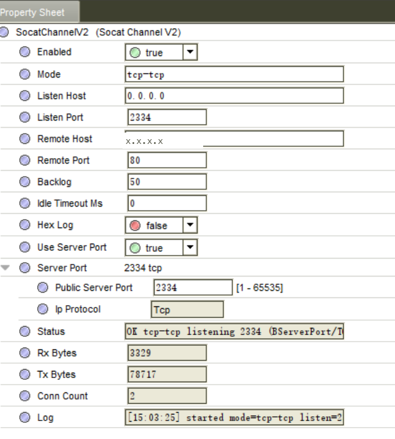
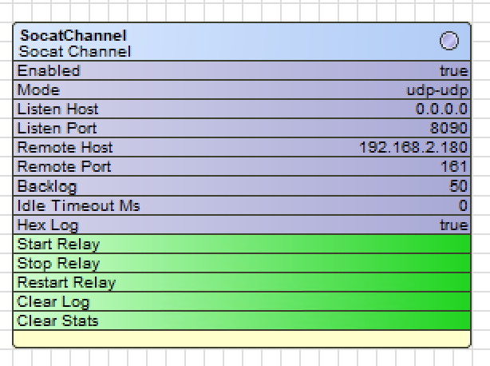
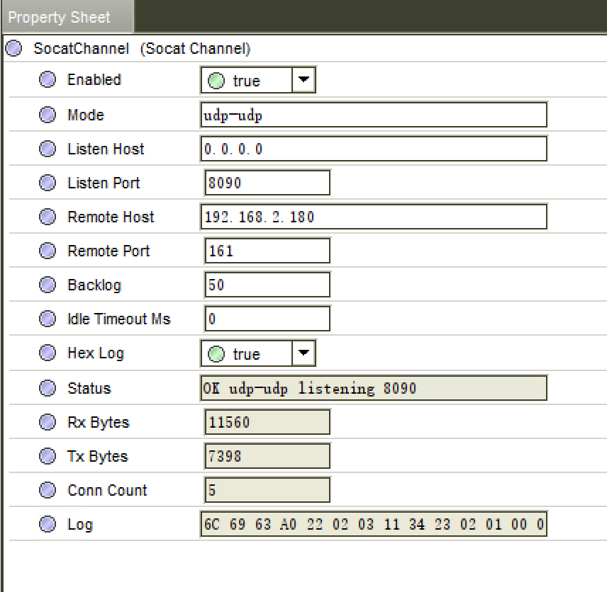
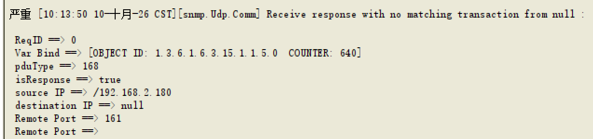

# glineSocatV2 — Firewall-Aware TCP/UDP Relay for Niagara (4.15 / Jace-9000)

**glineSocatV2** is the current, **firewall-aware** build of the **glineSocat** relay family.
This page leads with V2; **glineSocat** (V1) and **glinePortFwd** are documented further down.

**glineSocat** is part of the **glineRelay** family — native **Niagara 4** components that
add a *socat-style* TCP/UDP relay **and** a plain port forwarder to a station.
Drag a component into a station, fill in a few slots, and the station forwards traffic
between a local listening port and a remote target — including **protocol bridging**
between TCP and UDP.

> This repository contains **documentation and screenshots only**.
> It does **not** include source code or compiled `.jar` files.
> To request the module — **source or build** — contact us by email (see *Request the module*).

---

---

## Why this service exists

A JACE already sits **between two networks** — it has a port on the building's
**enterprise LAN** (where the field devices live) and it is reachable from the
**integrator's side**. That position makes it the natural place to put a
*socat-style* relay: use the JACE as a **port-forwarding bridge**, so a device on the
internal network can be reached and debugged from outside it — **without putting any
integrator PC onto the enterprise network.**

### The problem it solves

Commissioning and troubleshooting a JACE station usually means talking directly to the
devices behind it — PLCs, DDCs, controllers, meters. In real projects that is often
hard or impossible:

| Obstacle | What it means in practice |
|:--|:--|
| **No PC on the enterprise LAN** | The integrator's laptop is **not allowed** to join the customer's internal network — it is not managed, not patched, not trusted. |
| **Devices are physically remote** | The DDC / PLC sits in a plant room, on another floor, or in a different building — a site visit per change is expensive. |
| **Extra licensing** | The engineering tool may need its own licence (for example a **Spyder** licence) just to open a session to the device. |
| **No direct route** | The device is on a subnet the integrator has no path to at all. |

### How the JACE solves it

The JACE **does** have a route to those devices. Put a relay component on the JACE and
it can:

1. **Listen on the JACE** for a port you choose,
2. **Forward** that port to the internal device (PLC / DDC / any TCP or UDP service),
3. Let the integrator's PC connect to **the JACE's second network interface** — and
   reach the internal device **through** the JACE.

The PC never joins the enterprise network, the device never needs to be exposed
directly, and no per-device licence is needed just to reach it. **`glineSocat` works
the same way for TCP and UDP**, and can bridge between the two protocols
(`tcp-udp` / `udp-tcp`) — useful for SNMP, Modbus, and other mixed traffic.

Typical uses:

- **Debug a PLC or DDC** on the internal LAN from the integrator's workstation.
- **Reach a distant plant room** without sending an engineer to site.
- **Avoid extra tool licensing** — the relay is a plain socket forward, not an
  engineering-tool session.
- **Temporarily expose** a service that has no other route.

### Close the port when you are done

> **Security note.** The relay is an **open port on the JACE** for as long as it runs.
> Treat a debug relay as a **temporary maintenance window**: when commissioning or
> troubleshooting is finished, **stop the component or disable the port**, so the
> internal device is not left reachable. Keep the listening host restricted, and never
> leave a relay open on a site unattended.

## What glineSocatV2 does

- Type: **`SocatChannelV2`** (module `glineSocatV2`)
- Same relay engine and the same **4 modes** as `glineSocat`, with one important addition:
  **the listening port is opened on the firewall automatically.**



*The `SocatChannelV2` property sheet: `mode`, `useServerPort`, `serverPort`
(`publicServerPort` + `ipProtocol`), and the read-only `status` line — example above shows
`OK tcp-tcp listening 2334 (BServerPort/TCP)`.*

### The problem it solves

A **Jace-9000** running **Niagara 4.15+** uses an **nftables** firewall for inbound traffic.
That firewall only trusts ports that are declared through a Niagara `BServerPort` object —
it opens the matching inbound rule by itself and removes it when the object stops.

`glineSocat` (V1) stores its port as a plain number, which the firewall does not recognise.
The result is confusing: the component reports `status = OK ... listening`, the log says
`started`, yet **external connections time out forever**, because the inbound packets are
dropped. The workaround was to add a `FirewallPortHelper` by hand for every port.

`glineSocatV2` declares its port through a `BServerPort` instead, so the firewall opens it
automatically. **No manual firewall rule, no per-port helper.**

### Added / changed slots

| Slot | Type | Default | Description |
|:--|:--|:--|:--|
| `useServerPort` | boolean | `true` | `true` = listen on the port declared by `serverPort` (**firewall opens it automatically**). `false` = fall back to `listenPort` (the V1 behaviour). |
| `serverPort` | BServerPort | `(2333, UDP)` | The firewall keys off this object. **Set its `publicServerPort` to your listening port.** |
| `listenPort` | int | `8090` | Kept as a fallback for backward compatibility. |

Port resolution order:

```
useServerPort == true  AND  serverPort.publicServerPort > 0
        -> listen on serverPort's port     (firewall opened automatically)  [recommended]
otherwise
        -> listen on listenPort            (V1 behaviour; needs a manual firewall rule)
```

All other slots (`mode`, `listenHost`, `remoteHost`, `remotePort`, `backlog`,
`idleTimeoutMs`, `hexLog`, and the read-only `status` / `rxBytes` / `txBytes` /
`connCount` / `log`) work exactly as in `glineSocat`.

### New action: `syncProtocol`

`mode` decides whether the listener is TCP or UDP. V2 keeps the firewall protocol in step
with `mode` **automatically** — on a `mode` change, and again when the station starts —
so the firewall always opens the right protocol.

In V1 the two were independent, which caused a second, subtler failure: a component set to
`tcp-tcp` could still carry `ipProtocol = udp`, so the firewall opened the **wrong**
protocol and inbound traffic was dropped with no error at the socket. V2 removes this
class of problem.

`syncProtocol` is also exposed as a manual action, for use after any out-of-band change.
The read-only `status` now reports the port source and protocol (for example
`(BServerPort/udp)`), and warns `!protoMismatch(...)` if the two ever disagree.

### Quick start (glineSocatV2)

**Goal:** relay SNMP to a device at `192.168.1.100:161` through a Jace-9000, with the port
opened automatically.

1. Create a `SocatChannelV2` under e.g. `slot:/PortForward/`.
2. Set the slots:

   | Slot | Value |
   |:--|:--|
   | `mode` | `udp-udp` |
   | `useServerPort` | `true` |
   | `serverPort.publicServerPort` | `2333` (your chosen listening port) |
   | `remoteHost` | `192.168.1.100` |
   | `remotePort` | `161` |

3. Save, then call `restartRelay`.
4. Verify: `snmpget -v1 -c public 192.168.1.10:2333 <OID>` reaches the device, and
   `status` shows the expected port and protocol.

> `glineSocat` (V1) and `glineSocatV2` **coexist** on the same host. Existing V1 stations
> need no change; use V2 for new stations and for stations where the port must be opened
> automatically.

### Compatibility

| | |
|:--|:--|
| Target platform | **Niagara 4.15 / Jace-9000** (nftables firewall) |
| Module dependency | `baja` 4.14 — loads on 4.14 and 4.15 hosts |
| Signed | yes, by Shanghai Gline Net Co. |

---

## Components

`glineRelay` provides two native Niagara components. Both run **inside** the station and
begin listening together with the station — no extra process to babysit.

| Component | Type | Capability |
|:--|:--|:--|
| **glineSocat** | `glineSocat:SocatChannel` | socat-style relay with **4 modes**: `tcp-tcp` / `udp-udp` / `tcp-udp` / `udp-tcp` |
| **glineSocatV2** | `glineSocatV2:SocatChannelV2` | as above, plus **automatic firewall opening** on Jace-9000 — see *glineSocatV2* below |
| **glinePortFwd** | `glinePortFwd:PortForward` | plain port forwarding, **TCP or UDP** (same protocol on both sides) |

> The difference: **glinePortFwd** can only forward *TCP→TCP* or *UDP→UDP*.
> **glineSocat** additionally **bridges protocols** (`tcp-udp` / `udp-tcp`) — something a
> plain port forwarder cannot do.

---

## Why a station component (and not an external tool)

A relay is often needed inside a controller: forward an external port to an internal
device, bridge one protocol to another, or expose a field device on another subnet.
Instead of running an extra `socat` / port-forwarder process next to the station,
these components run **inside** the station:

- **Tied to the station lifecycle** — begins listening when the station starts, stops when it stops. No extra service, no scheduled task, no watchdog.
- **No extra software** — nothing to install on the host besides the module itself.
- **Managed by Niagara** — status, byte counters and logs are ordinary station slots, visible in Workbench / Web / oBIX.
- **Protocol bridging** — `tcp-udp` and `udp-tcp` convert between TCP and UDP.

---

## Screenshots

**Component and status**



The component sits under any folder in the station (example: `PortForward/`); at runtime
`status` shows the current listening state.

**Slot sheet**



**UDP relay debug log (hex)**



---

## glineSocat — the relay

- Type: **`SocatChannel`** (module `glineSocat`)
- Placed under any folder in the station, e.g. `slot:/PortForward/SocatChannel`

### Modes

`mode` decides the direction **and whether the listener is TCP or UDP**:

| mode      | Client → Station | Station → Target | Typical use                                        |
|:----------|:-----------------|:-----------------|:---------------------------------------------------|
| `tcp-tcp` | TCP              | TCP              | Web, Modbus/TCP, any TCP service                   |
| `udp-udp` | UDP              | UDP              | SNMP polling, simple UDP queries                   |
| `tcp-udp` | TCP              | UDP              | TCP-only client → UDP-only device (e.g. SNMP)      |
| `udp-tcp` | UDP              | TCP              | UDP-only client → TCP/HTTP service                 |

> `tcp-tcp` / `tcp-udp` open a **TCP** listener; `udp-udp` / `udp-tcp` open a **UDP** listener.

### Writable slots

| Slot | Type | Default | What it does / how to fill it |
|:--|:--|:--|:--|
| `enabled` | boolean | `true` | Master switch. `true` → the relay starts automatically **when the station starts**. `false` → idle until you call `startRelay`. |
| `mode` | string | `tcp-tcp` | Direction, exactly one of `tcp-tcp` / `udp-udp` / `tcp-udp` / `udp-tcp`. Also decides TCP-vs-UDP listener. |
| `listenHost` | string | `0.0.0.0` | Local bind address. `0.0.0.0` = all interfaces; set a specific local IP to limit exposure. |
| `listenPort` | int | `8090` | Local listening port. Must be free on the station host. |
| `remoteHost` | string | (empty) | Target address (IP or hostname), e.g. `192.168.1.100`. **Required** — if empty, connections fail. |
| `remotePort` | int | `80` | Target port, e.g. `80` / `161` / `502`. |
| `backlog` | int | `50` | TCP **accept-queue** length (handshaken-but-not-accepted connections). **Used only in TCP modes** (`tcp-tcp`, `tcp-udp`). **Not** a max-connection limit. 50 is fine; raise to ~128 for bursts. |
| `idleTimeoutMs` | int | `0` | Idle/read timeout in ms. **Meaning depends on the mode** (table below). |
| `hexLog` | boolean | `false` | When `true`, payloads passing through are written to `log` as hex (**up to 64 bytes per line**). Debug only — verbose. |

### Read-only slots

| Slot | Type | Description |
|:--|:--|:--|
| `status` | string | Runtime state, e.g. `OK tcp-tcp listening 8090`, `stopped`, or `ERR <ExceptionClass>: <message>` (e.g. a bind failure). |
| `rxBytes` | long | Total bytes **received** from the client side. |
| `txBytes` | long | Total bytes **sent** back to the client side. |
| `connCount` | int | Total TCP connections accepted. **Counts TCP accepts only** — stays `0` for `udp-udp` / `udp-tcp`. |
| `log` | string | Operation log; keeps the **last 4000 characters**. |

### Actions

| Action | Effect | When to use |
|:--|:--|:--|
| `startRelay` | Start the listener / relay | when `enabled = false` and you want to start manually |
| `stopRelay` | Stop the relay; close all connections | before maintenance or reconfiguring |
| `restartRelay` | Stop then start (hot reload) | **after changing any slot** |
| `clearLog` | Empty `log` | when the log is long |
| `clearStats` | Reset `rxBytes` / `txBytes` / `connCount` to 0 | before a fresh measurement |

### `idleTimeoutMs` — semantics by mode

| mode | Where the timeout is applied | When `0` |
|:--|:--|:--|
| `tcp-tcp` | read timeout on both the client and the upstream socket | **no timeout** — connections stay open until a side closes |
| `tcp-udp` | how long to wait for the **UDP reply** | internal default **4000 ms** |
| `udp-udp` | how long to wait for the **UDP reply** | internal default **4000 ms** |
| `udp-tcp` | read timeout on the upstream **TCP** socket | no timeout (the handler waits for the response) |

---

## glinePortFwd — the plain port forwarder

- Type: **`PortForward`** (module `glinePortFwd`)
- Forwards a local port to a remote target, **same protocol on both sides**
  (TCP→TCP or UDP→UDP). For protocol bridging, use `glineSocat` instead.

### Slots

| Slot | Type | Default | Description |
|:--|:--|:--|:--|
| `listenPort` | int | `8090` | Local listening port. **When > 0 the forwarder starts with the station.** |
| `remoteHost` | string | (empty) | Target address (IP or hostname). Required. |
| `remotePort` | int | `80` | Target port. |
| `udpMode` | boolean | `false` | `false` = TCP forward; `true` = UDP forward. |
| `status` | string (read-only) | — | Runtime state, e.g. `OK listening 8098/tcp`. |

### Actions

`startFwd` / `stopFwd`.

### Notes

- UDP forwarding is strictly **one request → one reply** (each packet opens a fresh socket and waits up to ~4 s for a reply).
- There is no `enabled` master switch — the forwarder starts automatically at station start when `listenPort > 0`.

---

---

## Quick start (glineSocat)

**Goal:** expose device `192.168.1.100:80` through the station at `192.168.1.10:8090`.

1. In Workbench, create a `SocatChannel` under e.g. `slot:/PortForward/`.
2. Set the slots:

   | Slot | Value |
   |:--|:--|
   | `mode` | `tcp-tcp` |
   | `listenHost` | `0.0.0.0` |
   | `listenPort` | `8090` |
   | `remoteHost` | `192.168.1.100` |
   | `remotePort` | `80` |

3. Call `restartRelay` (or restart the station the first time).
4. Verify: browsing `http://192.168.1.10:8090/` reaches the device;
   `status` shows `OK tcp-tcp listening 8090`; `connCount` increases.

### Example configuration per mode

| mode      | listen | remote            | verify with |
|:----------|:-------|:------------------|:------------|
| `tcp-tcp` | `:8090`| `192.168.1.100:80`| `curl http://192.168.1.10:8090/` |
| `udp-udp` | `:8091`| `192.168.1.100:161`| `snmpget -v1 -c public 192.168.1.10:8091 <OID>` |
| `tcp-udp` | `:8092`| `192.168.1.100:161`| a TCP client sends a raw SNMP request |
| `udp-tcp` | `:8093`| `192.168.1.100:80` | a UDP client sends `GET / HTTP/1.0` |

> Addresses above are illustrative RFC1918 examples — replace them with your own.

---

## Capacity & performance

| Question | Answer |
|:--|:--|
| Max clients? | No hard limit and no rate-limiting slot — it accepts what it gets. |
| Thread per connection? | One handler thread per TCP connection; one thread per UDP packet when bridging. |
| Is `backlog` the cap? | No — it is only the TCP accept queue. |
| Real ceiling? | JVM threads / file descriptors / memory — not bandwidth. |

**CPU:** near-zero when idle (threads blocked on read); low while relaying.
The main costs are **open connections** (especially long-lived ones) and **`hexLog`**.

*Recommendation:* fine for typical use up to ~200 concurrent TCP connections;
cap `idleTimeoutMs` if you have many long-lived connections, and do not leave
`hexLog` on.

---

## Troubleshooting

| Symptom | Likely cause | Fix |
|:--|:--|:--|
| `status` = bind error | `listenPort` already in use | change the port |
| `listening` but no connection | firewall / target unreachable | check firewall; read `log` |
| `tcp bridge err` in `log` | wrong `remoteHost`/`remotePort`, or target down | verify the target port |
| Changed config, no effect | not reloaded | call `restartRelay` |
| UDP gets no reply | target silent / slow | increase `idleTimeoutMs`; confirm request/reply |
| Need to inspect traffic | — | temporarily set `hexLog = true`, then turn it off |

---

## Notes & cautions

1. **After any slot change, call `restartRelay`.** Editing slots does **not** rebind the listener. The only automatic start is at station start when `enabled = true` (glineSocat) / `listenPort > 0` (glinePortFwd).
2. **Binding can fail** — if `listenPort` is taken, `status` shows an `ERR ...` message and nothing is relayed.
3. **`backlog` only affects the TCP modes** (`tcp-tcp`, `tcp-udp`).
4. **UDP modes are strictly one request → one reply.** Each packet opens a fresh socket and waits for a single reply — no streaming, no server push, no multi-packet flows.
5. **`connCount` counts TCP accepts only** — it does not rise for `udp-udp` / `udp-tcp`.
6. **`hexLog` is verbose** — each entry is capped at 64 bytes and the `log` keeps only the last 4000 chars. Leave it off outside debugging.
7. **Security — this is an open relay.** With `listenHost = 0.0.0.0` anything that can reach `listenPort` can reach `remoteHost:remotePort`. Restrict with a firewall or bind a specific IP. Traffic is **plain TCP/UDP (no TLS)**.
8. **One component = one listener/target pair.** For several forwards, add several components — make sure every `listenPort` is unique.
9. **Use a maintenance window to (re)deploy.** Adding/replacing the module on a running station needs the Niagara service to restart; do it in a planned outage.

---

## Request the module

Want to try **glineSocat**, **glineSocatV2** and **glinePortFwd** on your own Niagara
station, or want the module source / a build?

📧 Email **jason.zhang@gline-net.com** with your use case and we'll get back to you.

---

## Notes

- This repository contains **documentation and screenshots only** — no source code, no `.jar`, no credentials. Source and builds are available on request (see *Request the module*).
- All addresses / ports in the examples are illustrative.

*Last updated: 2026-10-14*
